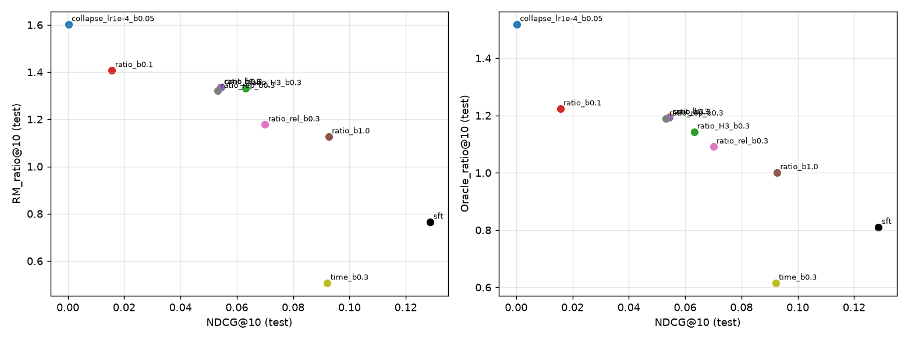
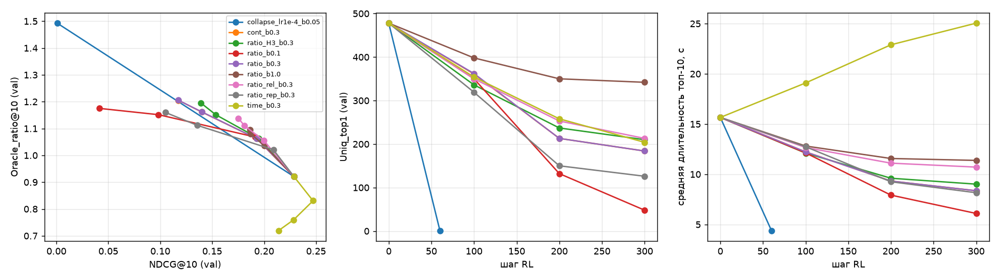
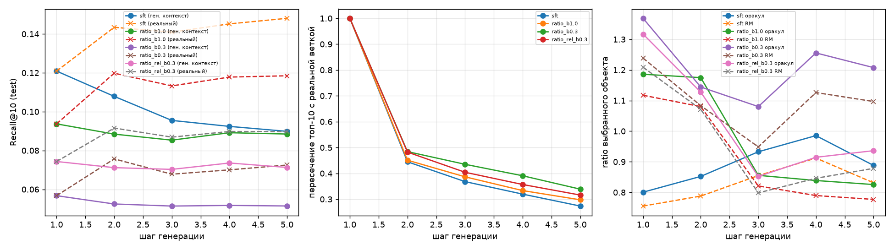

# Обучение с подкреплением для рекомендации видео (KuaiRec)

Я обучил модель, которая по истории просмотров пользователя предсказывает следующее видео, и дообучил её с подкреплением (RL), чтобы рекомендации чаще досматривали. Данные - KuaiRec, логи просмотров коротких видео в приложении Kuaishou.

## Воспроизведение

Окружение (CPU, Python 3.11+):

```bash
python -m venv .venv
.venv/Scripts/pip install -r requirements.txt   # Linux/macOS: .venv/bin/pip
```

Положите KuaiRec 2.0 в `data/raw/kuairec/KuaiRec 2.0/data/` (нужны `big_matrix.csv` и `small_matrix.csv`), затем:

```bash
python scripts/prepare_data.py          # признаки и разбиение -> data/processed/kuairec
python scripts/train_sft.py             # базовая модель -> artifacts/sft
python scripts/eval_test.py             # оценка SFT на test
python scripts/train_rm.py              # модель вознаграждения и её оценка -> artifacts/rm/eval.json
bash scripts/run_grid.sh                # 8 RL-запусков -> artifacts/rl/<имя>/
python scripts/rollout.py --policies sft=artifacts/sft/model.pt ratio_b1.0=artifacts/rl/ratio_b1.0/model.pt
python scripts/rollout.py --no_repeat --out artifacts/rollout_norep.json --policies ...
python scripts/plots.py                 # графики -> reports/figures
```

Модель, которая всем рекомендует одно видео (см. «Без достаточного штрафа модель вырождается»): `python scripts/train_rl.py --out artifacts/rl/collapse --steps 60 --lr 1e-4 --beta 0.05`.

Код в `src/rlrec/`: `data.py` - признаки и разбиение, `model.py` - SFT и RM, `rl.py` - RLOO и варианты вознаграждения, `metrics.py` и `evaluate.py` - метрики и общий протокол оценки.

## Аннотация

Главная метрика - доля досмотра, то есть какую часть видео пользователь посмотрел (1 - до конца, больше 1 - с повтором). В KuaiRec есть 1411 пользователей, которым показали почти все 3327 видео из отдельного набора, поэтому для их рекомендаций досмотр известен из данных. У исходной модели он равен 0,81, после RL - от 1,00 до 1,22 в зависимости от настроек. Рост идёт за счёт коротких видео: средняя длительность рекомендаций падает с 18,5 до 5-10 секунд. Модель при этом хуже угадывает реальные просмотры и рекомендует меньше разных видео.

Насколько далеко модель уходит от исходной, определяет вес $\beta$ штрафа за отклонение от неё. Чем меньше $\beta$, тем выше досмотр и тем хуже модель угадывает реальные просмотры: при $\beta=1{,}0$ точность угадывания (NDCG@10) падает на 28 %, при $\beta=0{,}1$ - в 8 раз. С ещё меньшим штрафом и большей скоростью обучения модель за 22 секунды стала ставить всем пользователям на первое место одно и то же видео.

Если вознаграждать время просмотра, модель уходит в длинные видео, и доля досмотра падает ниже исходной. Вознаграждение за продолжение сессии ни на что не повлияло, потому что модель вознаграждения предсказывает продолжение почти одинаково для всех видео.

Если модель 5 раз подряд выбирает видео и дописывает его в историю, она начиная со второго шага выбирает то же видео, что только что добавила. Если повторы запретить, к пятому шагу её топ-10 совпадает с топ-10 по реальной истории пользователя только на треть.

## Задача и подход

1. **Базовая модель.** Небольшая GPT-2 читает последовательность просмотренных видео и предсказывает следующее, как языковая модель предсказывает следующее слово. Далее её называем SFT (supervised fine-tuning - обучение с учителем на логах просмотров).
2. **Модель вознаграждения (reward model, RM).** Отдельная сеть того же размера по истории пользователя и видео-кандидату предсказывает три величины: какую долю видео пользователь посмотрит, продолжит ли он сессию и вернётся ли в течение суток.
3. **RL.** SFT дообучаю так, чтобы её рекомендации получали высокую оценку RM. Чтобы модель не ушла слишком далеко от исходной, добавляем штраф за расхождение с SFT.

Метод RL - RLOO (REINFORCE Leave-One-Out), вариант алгоритма градиента политики REINFORCE. Для каждой истории модель предлагает 8 видео, каждое получает вознаграждение от RM, и вероятность видео повышается, если его вознаграждение выше среднего по остальным 7. Подход взят из двух статей - о REINFORCE с моделью отклика пользователя (arXiv:2607.02818) и о GPTRec, дообученном методом PPO (Proximal Policy Optimization; arXiv:2403.04875). PPO я заменил на RLOO, потому что RLOO не нужен критик (отдельная сеть, оценивающая функцию ценности), и обучение укладывается в бюджет CPU.

Всё посчитано на CPU примерно за полтора часа: SFT около часа, RM около 15 минут, один RL-запуск около 5 минут.

## Данные

Датасет KuaiRec 2.0 - просмотры коротких видео в приложении Kuaishou.

- **Большая матрица**: 7176 пользователей, 10 728 видео, 12,53 млн просмотров. На ней я обучаю и оцениваю модели.
- **Малая матрица**: 1411 пользователей × 3327 видео, почти каждый пользователь посмотрел почти каждое видео (4,49 млн пар). Ни одна пара из неё не встречается в большой матрице. Её я использую как «оракул»: если модель рекомендует видео из малой матрицы, известно, как пользователь на него на самом деле отреагировал, и рекомендации можно проверить без модели вознаграждения.

Для каждого просмотра я считаю отклик:

- **доля досмотра** `ratio` - сколько видео посмотрено, в долях длины, с ограничением сверху 3 (повторный просмотр даёт больше 1);
- **продолжение сессии** - следующий просмотр начался не позже чем через 30 минут;
- **возврат** - следующий просмотр после паузы от 30 минут до 24 часов.

Около 18 % просмотров - повторный просмотр уже виденного видео.

Данные разбиты по времени: первые 80 % событий идут на обучение (train), следующие 10 % - на валидацию (val), последние 10 % - на итоговую проверку (test). При оценке модель видит только события до начала периода оценки. Продолжение сессии и возврат считаются только внутри своего периода, чтобы не заглядывать в следующий; у последнего просмотра пользователя в периоде они неизвестны и не используются.

## Модели и настройки

**SFT.** GPT-2 из 2 слоёв с размерностью скрытого состояния 128, история до 100 последних видео. 3 эпохи, скорость обучения до $10^{-3}$.

**RM.** GPT-2 того же размера. На вход подаются пары (видео, насколько его досмотрели) из истории, плюс видео-кандидат и его длительность.

**RL.** Дообучаемая модель $\pi_\theta$ с параметрами $\theta$ по истории пользователя $x$ выдаёт распределение $\pi_\theta(\cdot\mid x)$ на каталоге видео. Максимизирую

$$
J(\theta)=\mathbb E_{a\sim\pi_\theta}\left[r(x,a)\right]-\beta\,\mathrm{KL}\left(\pi_\theta(\cdot\mid x)\,\Vert\,\pi_{\text{SFT}}(\cdot\mid x)\right),
$$

где $a$ - видео, выбранное из $\pi_\theta(\cdot\mid x)$; $r(x,a)$ - вознаграждение (варианты ниже); $\mathbb E$ - математическое ожидание; $\pi_{\text{SFT}}$ - исходная модель; $\mathrm{KL}$ - расхождение Кульбака - Лейблера; $\beta\ge 0$ - вес штрафа. Настройки: 64 истории по 8 видео на шаг, 300 шагов, скорость обучения $10^{-5}$.

Варианты $r(x,a)$ приведены в таблице. Обозначу через $\hat y(x,a)$ прогноз RM для доли досмотра, через $\hat p_c(x,a)$ и $\hat p_{ret}(x,a)$ - прогнозы вероятностей продолжения сессии и возврата, через $d(a)$ - длительность видео $a$, через $\bar d$ - среднюю длительность по каталогу. В таблице аргументы $(x,a)$ опущены.

| Имя | $r(x,a)$ | Что проверяем |
|---|---|---|
| `ratio` | $\hat y$ | доля досмотра |
| `time` | $\hat y\cdot d(a)/\bar d$ | время просмотра |
| `cont` | $\hat y+\hat p_c+\hat p_{ret}$ | долгосрочное поведение |
| `rep` | $\hat y-0{,}5\cdot\mathbb 1[a\in x]$ | меньше повторов |
| `rel` | $\hat y+0{,}1\cdot\log\pi_{\text{SFT}}(a\mid x)$ | удержание релевантности |
| `H3` | $\sum_{t=0}^{2}\gamma^t\,\hat y(x_t,a_t)$, $\gamma=0{,}9$ | цепочка рекомендаций вместо одной |

Здесь $\mathbb 1[a\in x]$ равно 1, если видео $a$ уже есть в истории $x$, и 0 иначе. В `H3` модель выбирает 3 видео подряд: $x_0=x$, а $x_{t+1}$ - история $x_t$, к которой дописано видео $a_t$ со случайным откликом, разыгранным по $\hat y(x_t,a_t)$; $\gamma$ - коэффициент дисконтирования.

## Метрики

Правильные ответы для пользователя (множество $G$) - все видео, которые он посмотрел в периоде оценки. Модель ранжирует весь каталог; топ-10 - первые 10 позиций. Каждая метрика усредняется по пользователям.

**Точность.**
- Recall@10 - число правильных ответов в топ-10, делённое на $\min(10,\lvert G\rvert)$.
- NDCG@10 (normalized discounted cumulative gain) - то же с учётом позиции: попадание на позиции $k$ весит $1/\log_2(k+1)$, сумма делится на максимально возможную.
- MAP@10 (mean average precision) - для каждой позиции попадания $k$ берётся доля правильных ответов среди первых $k$ позиций, сумма этих долей делится на $\min(10,\lvert G\rvert)$.
- new_NDCG@10 - NDCG, в которой видео из истории пользователя убраны и из топа, и из правильных ответов. Она показывает, как модель угадывает новые для пользователя видео: SFT в 56 % позиций рекомендует то, что пользователь уже видел.

**Разнообразие** - проверяем, не рекомендует ли модель всем одно и то же.
- Coverage@10 - доля каталога, попавшая хоть в чей-то топ-10.
- Uniq_top1 - сколько разных видео стоит на первом месте у всех пользователей.
- Top1_share - доля пользователей, у которых на первом месте стоит самое частое первое видео. 1,0 значит, что всем рекомендуется одно и то же.

**Вознаграждение.**
- RM_ratio@10 - средняя доля досмотра топ-10 по прогнозу RM.
- Oracle_ratio@10 - фактическая доля досмотра топ-10 по малой матрице. Чтобы реакция на каждую рекомендацию была известна, для 1410 пользователей малой матрицы модель выбирает топ-10 только среди её 3327 видео.

## Результаты

### Модель вознаграждения

Проверка на событиях из test, которых RM не видела. AUC - площадь под ROC-кривой, то есть вероятность, что случайный положительный пример получит прогноз выше случайного отрицательного; 0,5 соответствует угадыванию.

| Метрика | RM | Константный прогноз |
|---|---|---|
| Среднеквадратичная ошибка прогноза доли досмотра (RMSE) | 0,566 | 0,701 |
| Корреляция Спирмена с фактом | 0,63 | - |
| AUC: доля досмотра ≥ 1 / ≥ 2 | 0,83 / 0,79 | 0,5 |
| AUC: продолжит ли сессию / вернётся ли | 0,74 / 0,74 | 0,5 |

Я разбил видео на 8 групп по длительности. В каждой группе прогноз в среднем отличается от факта на −0,06…+0,01, то есть RM не завышает досмотр ни коротких, ни длинных видео.

На малой матрице (пары, которых не было в обучении) корреляция Спирмена с фактом 0,59, внутри одного пользователя 0,67. Если каждому пользователю взять 10 видео с лучшим прогнозом RM, они фактически досматриваются на 2,14. Случайные 10 видео дают 0,86, лучшие возможные - 2,94. RM годится как источник вознаграждения, но ошибается заметно.

### Базовая модель и RL

Результаты на test. В первом столбце - вариант вознаграждения и вес штрафа $\beta$.

| Модель | Recall@10 | NDCG@10 | MAP@10 | new_NDCG@10 | Coverage@10 | Uniq_top1 | Top1_share |
|---|---|---|---|---|---|---|---|
| SFT | 0,121 | 0,129 | 0,056 | 0,185 | 0,130 | 639 | 0,32 |
| ratio, $\beta=1{,}0$ | 0,094 | 0,093 | 0,039 | 0,148 | 0,127 | 549 | 0,12 |
| time, $\beta=0{,}3$ | 0,093 | 0,092 | 0,037 | 0,133 | 0,070 | 273 | 0,16 |
| rel, $\beta=0{,}3$ | 0,074 | 0,070 | 0,029 | 0,123 | 0,117 | 423 | 0,14 |
| H3, $\beta=0{,}3$ | 0,065 | 0,063 | 0,026 | 0,091 | 0,099 | 336 | 0,23 |
| ratio, $\beta=0{,}3$ | 0,057 | 0,054 | 0,022 | 0,077 | 0,077 | 251 | 0,27 |
| cont, $\beta=0{,}3$ | 0,057 | 0,054 | 0,022 | 0,077 | 0,077 | 250 | 0,27 |
| rep, $\beta=0{,}3$ | 0,054 | 0,053 | 0,023 | 0,072 | 0,065 | 199 | 0,45 |
| ratio, $\beta=0{,}1$ | 0,016 | 0,016 | 0,006 | 0,020 | 0,026 | 53 | 0,25 |
| ratio, $\beta=0{,}05$, скорость обучения $10^{-4}$ | 0,000 | 0,000 | 0,000 | 0,001 | 0,004 | 1 | 1,00 |

| Модель | Средняя длительность видео в топ-10, с | Доля уже просмотренного в топ-10 | RM_ratio@10 | Oracle_ratio@10 |
|---|---|---|---|---|
| SFT | 18,5 | 0,56 | 0,77 | 0,81 |
| ratio, $\beta=1{,}0$ | 10,5 | 0,46 | 1,13 | 1,00 |
| time, $\beta=0{,}3$ | 35,6 | 0,50 | 0,51 | 0,62 |
| rel, $\beta=0{,}3$ | 9,4 | 0,45 | 1,18 | 1,09 |
| H3, $\beta=0{,}3$ | 6,8 | 0,31 | 1,33 | 1,14 |
| ratio, $\beta=0{,}3$ | 6,6 | 0,25 | 1,34 | 1,19 |
| cont, $\beta=0{,}3$ | 6,6 | 0,25 | 1,34 | 1,20 |
| rep, $\beta=0{,}3$ | 6,8 | 0,19 | 1,32 | 1,19 |
| ratio, $\beta=0{,}1$ | 5,5 | 0,14 | 1,41 | 1,22 |
| ratio, $\beta=0{,}05$, скорость обучения $10^{-4}$ | 4,4 | 0,24 | 1,60 | 1,52 |





**Надёжность различий.** Каждая конфигурация обучена один раз. Разброс между повторными запусками не измерен и, вероятно, больше разброса по пользователям. Разброс по пользователям я оценил бутстрепом - 1000 выборок с возвращением из 6881 пользователя test и 1410 пользователей оракула. 95-процентные доверительные интервалы: для NDCG@10 ±0,003, для разности NDCG двух моделей ±0,001-0,002, для Oracle_ratio@10 ±0,016.

За эти интервалы выходят отличия всех RL-моделей от SFT, различия между моделями с разным $\beta$ и отличие `time` от `ratio`. Не отличаются: `cont` от `ratio`, `rep` от `ratio` по досмотру, `time` от `ratio` с $\beta=1{,}0$ по NDCG.

**Оговорка про оракул.** Oracle_ratio считается только по парам, которые есть в малой матрице, - это 90-98 % рекомендаций. На видео малой матрицы рекомендации SFT досматривают на 0,81, а 10 случайных видео - на 0,86. Значит, по досмотру исходная модель хуже случайного выбора, и рост RL-моделей разумнее отсчитывать от 0,86.

### Что меняется в поведении модели

**Досмотр растёт за счёт коротких видео.** С вознаграждением `ratio` и $\beta=0{,}3$ фактическая доля досмотра растёт с 0,81 до 1,19, а средняя длительность рекомендаций падает с 18,5 до 6,6 с. Короткое видео проще досмотреть, и вознаграждение за долю досмотра поощряет короткие видео независимо от интересов пользователя.

**Модель не эксплуатирует ошибки RM.** RL мог бы найти видео, для которых RM завышает досмотр, и рекомендовать их (reward hacking). Тогда прогноз RM для рекомендаций превышал бы фактический досмотр. На деле RM занижает досмотр - на 0,04 у SFT и на 0,05-0,13 у RL-моделей.

**$\beta$ управляет компромиссом.** При $\beta=1{,}0$ у модели остаётся 72 % NDCG исходной и 86 % разных видео на первом месте, а фактический досмотр растёт с 0,81 до 1,00. При $\beta=0{,}1$ NDCG падает в 8 раз. Модели с разным $\beta$ ложатся на одну кривую «точность - досмотр» (первый график), и в ходе обучения каждая модель движется по этой же кривой (второй график).

**Без достаточного штрафа модель вырождается.** При $\beta=0{,}05$ и скорости обучения в 10 раз выше за 60 шагов (22 с) модель стала ставить на первое место всем пользователям одно и то же 4-секундное видео; её топ-10 покрывает 0,4 % каталога. Это видео действительно досматривают (1,52), но рекомендаций в собственном смысле такая модель уже не даёт.

**Вознаграждение за время просмотра даёт обратный эффект.** `time` выбирает длинные видео (35,6 с). Точность у этой модели выше, чем у `ratio` с тем же $\beta$, но доля досмотра падает ниже исходной (0,62), а Coverage@10 и Uniq_top1 вдвое меньше, чем у SFT. Вознаграждение определяет, к каким видео сдвигается модель, а $\beta$ - насколько далеко.

**Вознаграждение за продолжение сессии не действует.** `cont` и `ratio` обучались на одних и тех же случайных выборках и дали почти одну модель - первое видео совпадает у 98,9 % пользователей. RM предсказывает продолжение сессии почти одинаково для всех видео (0,865-0,886 у всех моделей), поэтому добавка почти не меняет порядок видео по вознаграждению. Прогноз возврата заметно выше только у `time` (0,131 против 0,106-0,118), потому что RM чаще ждёт возврата после длинных видео.

**Остальные варианты лучшего компромисса не дают.** `rel` и `H3` точнее `ratio` с тем же $\beta$, но и досматриваются хуже - 1,09 и 1,14 против 1,19. Обе точки лежат на той же кривой, что и модели с разным $\beta$. `rep` снижает долю повторов с 0,25 до 0,19, но Uniq_top1 падает с 251 до 199, а Top1_share растёт до 0,45.

### Генерация на 5 шагов вперёд

Для каждого пользователя test модель 5 раз подряд выбирает самое вероятное видео и дописывает его в историю, вместе со случайным откликом, разыгранным по прогнозу RM. Параллельно я строю вторую ветку, где в историю дописываются реальные следующие просмотры. Насколько модель «уплывает» от реальности, меряю пересечением топ-10 двух веток (доля общих видео). «Фактический досмотр» в таблицах ниже - доля досмотра выбранного видео по малой матрице, для её 1410 пользователей.

Recall реальной ветки с правильными ответами напрямую не сравниваю. Дописанные в неё просмотры сами входят в правильные ответы, а модели часто рекомендуют уже просмотренное, поэтому её Recall завышен. Recall сгенерированной ветки сравниваю с её первым шагом.

**Без ограничений все модели зацикливаются.** Со второго шага в 96-100 % случаев модель снова выбирает видео, которое только что сама добавила. Так она воспроизводит данные, где за просмотром часто идёт повторный просмотр того же видео.

| Модель | Recall@10, шаг 1 → 5 | Пересечение топ-10 с реальной веткой, шаг 5 | Фактический досмотр, шаг 1 → 5 |
|---|---|---|---|
| SFT | 0,121 → 0,114 | 0,51 | 0,80 → 0,81 |
| ratio, $\beta=1{,}0$ | 0,094 → 0,087 | 0,52 | 1,19 → 1,20 |
| rel, $\beta=0{,}3$ | 0,074 → 0,067 | 0,54 | 1,32 → 1,33 |
| ratio, $\beta=0{,}3$ | 0,057 → 0,050 | 0,54 | 1,37 → 1,37 |

К пятому шагу топ-10 совпадает с реальной веткой наполовину, Recall падает на 6-12 %. У RL-моделей расхождение не больше, чем у SFT.

**С запретом повторов** модель на каждом шаге предлагает новое видео:

| Модель | Пересечение топ-10, шаг 2 → 5 | Recall@10, шаг 1 → 5 | Фактический досмотр, шаги 1…5 |
|---|---|---|---|
| SFT | 0,45 → 0,27 | 0,121 → 0,090 | 0,80 · 0,85 · 0,93 · 0,99 · 0,89 |
| ratio, $\beta=1{,}0$ | 0,45 → 0,30 | 0,094 → 0,088 | 1,19 · 1,18 · 0,86 · 0,84 · 0,83 |
| rel, $\beta=0{,}3$ | 0,48 → 0,32 | 0,074 → 0,071 | 1,32 · 1,13 · 0,85 · 0,92 · 0,94 |
| ratio, $\beta=0{,}3$ | 0,48 → 0,34 | 0,057 → 0,051 | 1,37 · 1,14 · 1,08 · 1,26 · 1,21 |



К пятому шагу с реальной веткой совпадает около трети топа. Recall у SFT падает на 26 %, у RL-моделей на 4-11 %.

Фактический досмотр у двух RL-моделей к третьему шагу падает до уровня SFT. Вывести отсюда, что выигрыш RL пропадает на дальних шагах, нельзя. У 1410 пользователей оракула на каждом шаге выбрано всего 21-45 разных видео, и замена одного популярного видео сдвигает среднее на десятые. Гипотезу, что вознаграждение за один шаг не учит строить цепочку рекомендаций, результат не опровергает, но и не доказывает.

На графике генерации Recall реальной ветки завышен по причине, описанной выше.

## Что можно проверить офлайн, а что нет

По историческим данным проверяются точность относительно реальных просмотров, разнообразие и мгновенный досмотр (через малую матрицу).

Долгосрочный эффект офлайн не проверить. В логах нет пользователей, которым целый день показывали только короткие видео, поэтому неизвестно, вернутся ли такие пользователи завтра. RM обучена на логах старой системы рекомендаций и предсказывает, как пользователи вели себя при ней; как они поведут себя при новой, из этих логов не узнать. Долгосрочный эффект проверяется только A/B-тестом, где сравниваются время в приложении, число сессий в день, удержание на 7-й и 30-й день и суммарное время просмотра.

## Ограничения

- Вознаграждение в RL - прогноз RM, а не реакция пользователя. Оракул проверяет его только на 1410 пользователях и 3327 видео.
- В test отклик распределён иначе, чем в обучении: возвратов 13,3 % против 6,0 % в train и 6,6 % в val, продолжений сессии 86,6 % против 93,8 % и 93,4 %. Поэтому NDCG@10 у SFT на test 0,129, а на val 0,229. Модели сравниваются между собой на одних и тех же данных, так что сравнение это не искажает.
- Модели маленькие: 2 слоя, размерность скрытого состояния 128. Каждый вариант RL обучен один раз по 300 шагов. Веса добавок в `cont` (1) и `rel` (0,1), скорость обучения и число видео на историю (8) не подбирались.
- Для SFT взята последняя эпоха. Валидационная выборка использовалась для контроля обучения и подбора скорости обучения и $\beta$, тестовая - только для итоговых таблиц.
- В `H3` и при генерации отклик на сгенерированное видео разыгрывается из бета-распределения со средним по прогнозу RM. Форма распределения - моё допущение.
- PPO я не запускал.
